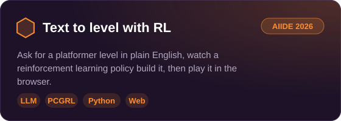
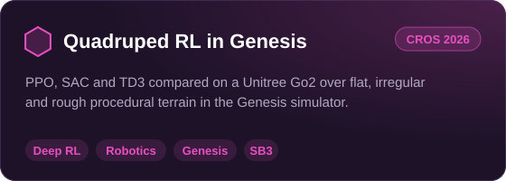
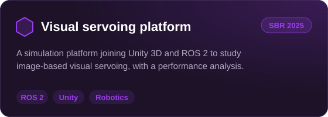
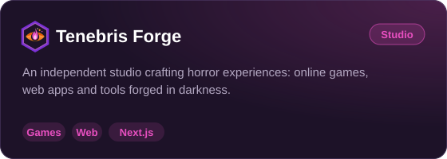

  

  
  
  
  

## About

I build software for a living and research how machines can make games.

- **Software Engineer III** at Nextpower, working remotely from Belo Horizonte, Brazil.
- **MSc student in Computer Science at UFMG**, advised by Luiz Chaimowicz: my dissertation turns
  a request written in plain language into a contract that a reinforcement learning agent
  satisfies while it builds a game level.
- **Founder of [Tenebris Forge](https://github.com/tenebris-forge)**, an independent studio for
  horror games, web apps and tools.
- Computer engineer from UFAL, where I spent years in research labs working on gamification
  analytics, robotics in simulation and educational software.

## Featured work

<table>
<tr>
<td width="50%"></td>
<td width="50%"></td>
</tr>
<tr>
<td width="50%"></td>
<td width="50%"></td>
</tr>
</table>

## Research

| Year | Venue | Paper | Links |
|---|---|---|---|
| 2026 | AIIDE | Did You Get the Level You Asked For? Bridging LLMs and PCGRL for Mario Level Generation | [paper](https://doi.org/10.1609/aiide.v22i1.43587) · [code](https://github.com/brunolemosdl/intent-pcgrl) · [demo](https://brunolemosdl.github.io/intent-pcgrl-demo/) |
| 2026 | CROS | Deep Reinforcement Learning for Quadruped Locomotion in Genesis: A Comparative Study of PPO, SAC, and TD3 in Irregular Terrains | [paper](https://doi.org/10.1109/CROS69211.2026.11565703) · [code](https://github.com/brunolemosdl/quadruped-rl-genesis) · [page](https://brunolemosdl.github.io/quadruped-rl-genesis/) |
| 2026 | WESAAC | A Multi-Agent System for Detection and Prioritization of Research Gaps in Scientific Literature | [paper](https://sol.sbc.org.br/index.php/wesaac/article/view/45243/45004) · code: [agents](https://github.com/Raksantos/research-gap-detection), [web app](https://github.com/Raksantos/research-gap-detection-front) |
| 2025 | SBR | A Comprehensive Simulation Platform for Image-Based Visual Servoing: Unity 3D and ROS 2 Integration with Performance Analysis | [paper](https://doi.org/10.1109/SBR/WRE66973.2025.11249603) |

Earlier work on gamification analytics for teachers (AIED 2020, SBIE 2020, ITS 2021, Education
and Information Technologies 2024) is on [Google Scholar](https://scholar.google.com/citations?user=h1Uk1bYAAAAJ).

## Tools I use

  

Forged in Belo Horizonte, Brazil.

